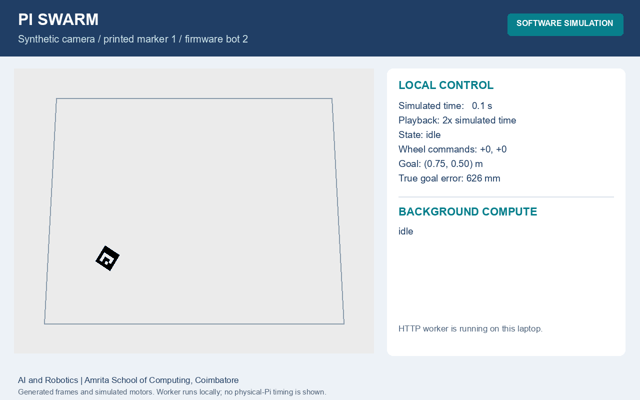
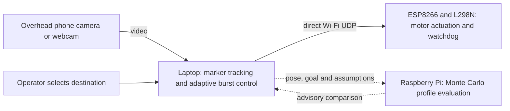

<div align="center">

# Pi Swarm
### Vision-Guided Robot Navigation with Background Edge Computing

An overhead camera observes. A laptop adapts and controls. A Raspberry Pi evaluates alternatives.

[](https://github.com/Kapilkannaa/pi-swarm-robotics/actions/workflows/tests.yml)


**[Read the report](reports/review2/review2.pdf)** · **[Watch the simulation](https://github.com/Kapilkannaa/pi-swarm-robotics/releases/download/review2-2026-11-03/Pi-Swarm-Simulation.mp4)** · **[Explore the design](docs/ARCHITECTURE.md)** · **[Run it locally](#run-the-simulation)**



*Generated camera images and simulated motors. The worker service runs locally in this recording.*

</div>

## What does the project do?

Pi Swarm explores camera-guided navigation for inexpensive robots with no onboard
position or distance sensors. The operator selects a destination in an overhead
phone-camera image or webcam view. The laptop estimates the robot's position and
heading, corrects its movement, and sends commands directly to an ESP8266 board.

Camera delay makes this harder than ordinary remote control: a command may still
be acting while the displayed image shows an older position. The controller uses
short motion bursts followed by observation periods. It learns approximate forward
and turning rates from the resulting movement instead of assuming identical motors.

The Raspberry Pi has a separate compute role. It evaluates three possible burst
profiles across randomized trajectories and returns a comparison. This analysis
does not block local control or replace a stop decision. Recommendations are shown
as advice and are not automatically applied to moving hardware.

## Start with these four items

| Item | What to look for |
|---|---|
| [Review 2 report](reports/review2/review2.pdf) | Problem, equations, design, implementation, results and references |
| [Simulation video and source](media/README.md) | Marker tracking, selected goal, lost-marker response and background computation |
| [Project guide](PROJECT_GUIDE.md) | Important entry points, robot identities and configuration |
| [Recorded evaluation](reports/review2/evidence/) | Scenario CSV, learning ablation, offload output and the full test log |

## How the parts work together



| Component | Responsibility |
|---|---|
| Camera | External visual sensing; ArUco marker supplies position and heading |
| Laptop | Calibration, click interface, online motion estimates and direct motor commands |
| ESP8266 robot | Parses wheel commands and enforces local watchdog/output limits |
| Raspberry Pi worker | Runs bounded trajectory simulations over authenticated HTTP |

The camera stream stays on the laptop. The worker receives compact state snapshots
and has no robot transport configuration. Worker failure leaves local control
available; lost camera tracking still causes a stop.

### Where AI and computation enter

- **Online system identification:** motion-rate and drift estimates adapt from observed movement.
- **Model-based evaluation:** the worker compares candidate controllers using Monte Carlo rollouts.
- **Optional classifier:** a separate red-round-token experiment uses logistic classification on
  synthetic data. Its scope and limits are in the [model card](models/MODEL_CARD.md).

Printed-marker detection is geometric computer vision. The project does not claim
a neural navigation model, robot-side TinyML or onboard obstacle detection.

## Recorded results

| Experiment | Result | Evaluation mode |
|---|---|---|
| Complete software suite | **181 passed** | Automated regression, firmware-model, transport and vision tests |
| Low-latency continuous control | 10/10 tasks completed | Seeded two-robot simulation |
| 0.3 s camera delay, adaptive burst control | **10/10 tests passed** | Seeded two-robot simulation |
| Burst control, 15% packet loss | 10/10 tasks completed | Seeded two-robot simulation |
| Poor initial motion estimates, learning on / off | 10/10 versus 0/10 waypoint courses | Learning ablation |
| Recorded video goal | 17.45 simulated seconds; 20.7 mm true final error | Single synthetic-camera demonstration |
| ESP8266 historical bench | 10/10 zero-speed commands accepted; recorded indicator/watchdog checks | Archived board-state records |

The two-robot scenario experiments and the single-robot video are different tasks.
Success rates from ten seeds describe those simulator runs, not real-world reliability.
See the [report](reports/review2/review2.pdf) for definitions and comparisons.

The team reported an earlier phone-camera click-to-go run. The robots were
dismantled before final documentation, so this submission uses archived bench
records and reproducible software evaluation. It contains no new hardware footage,
measured physical arrival-error series or current physical-Pi runtime benchmark.

## Run the simulation

Python 3.12 is the tested laptop environment. No camera, Pi or robot is needed.

```sh
python -m venv .venv
# Activate the environment for your operating system, then:
python -m pip install -r requirements.txt
python scripts/click_go.py --config config.example.toml --bot 2 --tracking aruco --marker-id 1 --dry-run
```

Left-click selects a goal; right-click or **x** stops; **q** closes the interface.
The synthetic run uses the same marker tracker and goal controller as the camera path.

Recreate the captioned simulation video:

```sh
python -m pip install -r requirements-demo.txt
python scripts/render_demo.py
```

The renderer writes an MP4, GIF excerpt, preview image, trajectory CSV and worker
result JSON to `media/`. A real authenticated HTTP request runs against a local
worker instance. No physical devices are contacted.

Reproduce the numerical evaluation:

```sh
python -m pytest -q
python scripts/reproduce_review2.py
```

Firmware comparison tests require `g++`. On Windows/MSYS2, include `ucrt64/bin` on
PATH so its runtime libraries are available. GitHub Actions runs the suite on Linux.

## Camera and robot configuration

The archived live path remains available for a reassembled platform. Copy
`config.example.toml` to private `config.toml` and set the arena dimensions, camera
source and robot address. Calibrate floor corners in order: bottom-left,
bottom-right, top-right, top-left.

```sh
python scripts/click_go.py --bot 2 --tracking aruco --marker-id 1 --source http://PHONE_IP:8080/video --recalibrate
```

`--source 0` selects a laptop webcam. `--tracking led` preserves the earlier
single-robot LED workflow. A printed marker's top edge points toward the robot's front.
**Firmware ID and printed marker ID are independent:** `--bot 2 --marker-id 1`
tracks printed marker 1 while addressing firmware robot 2. Two visible robots need
distinct printed identities.

The included firmware defaults to motor-disabled bench mode. Reassembly requires
checking power, wheel directions and calibration before deliberate motor enablement.
There are no onboard navigation sensors or obstacle avoidance.

### Raspberry Pi worker

On the Pi, install the compute-only service:

```sh
cd ~/pi-swarm
sh scripts/install_offload.sh
systemctl --user status pi-offload.service
```

The service requires Python 3.11+ standard-library modules. Privately copy its
`local_token.txt` to the laptop and add `--offload http://PI_IP:8770` to the laptop
command. Only the latest goal can receive advice; cancelled and stale results are
discarded. See [offloading details](docs/OFFLOADING.md).

## Source map

```text
swarm/
  vision/                  ArUco, LED detection, calibration and synthetic images
  sim/                     differential-drive world and firmware model
  marker_go.py             printed-marker goal controller
  control.py               continuous and adaptive burst control
  offload*.py              rollout evaluator, HTTP service and async client
scripts/                   camera runner, simulation renderer and hardware utilities
firmware/bot/              ESP8266 sketch and host-testable safety logic
tests/                     automated tests and firmware comparison harness
models/                    optional classifier and model card
media/                     simulation video, preview and recording outputs
docs/                      architecture, compute interface and hardware references
reports/review2/            PDF, LaTeX source, figures and numerical evidence
.github/workflows/         automated software checks
```

Legacy Pi-coordinator modules remain for regression coverage. The current entry
point is `scripts/click_go.py`; see [architecture history](docs/HISTORY.md).
Private settings, credentials, Wi-Fi headers and machine-specific binaries are excluded.

## Academic details

**Course:** AI and Robotics  
**Guide:** Dr. A. Baskar  
**Department:** Computer Science & Engineering  
**Institution:** Amrita School of Computing, Coimbatore

| Team member | Roll number |
|---|---|
| Kapil Kannaa G | CB.SC.U4CSE23036 |
| Mitali Patle | CB.SC.U4CSE23038 |
| Kavinraj S | CB.SC.U4CSE23329 |
| Gudi Hemanth | CB.SC.U4CSE23619 |
| D. Uday Kumar | CB.SC.U4CSE23655 |

**Acknowledgement:** The team thanks Dr. A. Baskar for guidance and the Department
of Computer Science & Engineering, Amrita School of Computing, Coimbatore, for
academic and laboratory support. Technical sources and dependencies are credited
in the report and [third-party notices](THIRD_PARTY_NOTICES.md).
