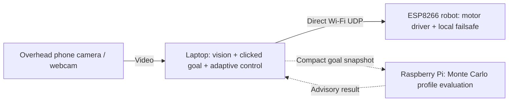

# Pi Swarm
### Vision-Guided Robot Navigation with Background Edge Computing

[](https://github.com/Kapilkannaa/pi-swarm-robotics/actions/workflows/tests.yml)

An **AI in Robotics semester project** using two ESP8266 robot platforms, an overhead
phone/laptop camera, a laptop controller, and a Raspberry Pi background worker.
Select a point in the camera image; the laptop guides the selected robot toward it.
The Pi evaluates alternative control profiles asynchronously, outside the motor-command path.

**[Review 2 report (PDF)](reports/review2/review2.pdf)** ·
**[Editable LaTeX](reports/review2/review2.tex)** ·
**[Start here / handoff](HANDOFF.md)** ·
**[Evaluation evidence](reports/review2/evidence/)**

## Academic details

**Course:** AI in Robotics — Semester Project  
**Guide:** Dr. A. Baskar  
**Department:** Computer Science & Engineering  
**Institution:** Amrita School of Computing, Coimbatore

| Team member | Roll number |
|---|---|
| Kapil Kannaa G | CB.SC.U4CSE23036 |
| Mitali Patle | CB.SC.U4CSE23038 |
| Kavinraj S | CB.SC.U4CSE23329 |
| Gudi Hemanth | CB.SC.U4CSE23619 |
| D. Uday Kumar | CB.SC.U4CSE23655 |

**Acknowledgement:** This project was carried out as part of AI in Robotics — Semester
Project, under the guidance of Dr. A. Baskar, Department of Computer Science & Engineering,
Amrita School of Computing, Coimbatore. The team acknowledges the course review framework,
institutional learning support, and the open-source tools credited in
[THIRD_PARTY_NOTICES.md](THIRD_PARTY_NOTICES.md).

## Architecture



**Camera video does not pass through the Pi.** The Pi does not send motor commands in
this architecture. Losing the worker does not block the laptop loop. Losing camera
tracking still stops the robot; the Pi is not a substitute for sensing.

## What is implemented

- Top-down camera tracking with **ArUco markers**, or the existing red-LED mode for one robot.
- Local click-to-go control using bounded bursts and online motion-rate/motor-drift learning.
- Firmware parsing, a 500 ms no-command watchdog, a 2.5 s marker pulse cap, re-arm logic,
  and a 72% PWM duty cap. Bench builds disable motor output by default.
- An optional authenticated Pi worker that compares three burst profiles using seeded
  trajectory simulations. Results are displayed/logged; recommendations are **not applied
  automatically to moving hardware**.
- Synthetic camera, firmware model, two-robot simulation and regression tests.
- An optional synthetic-data-trained red-round-token classifier, separate from the
  human-selected click-to-go task. See [model card](models/MODEL_CARD.md).

ArUco geometry is not a neural network. The adaptive element is online system
identification; Pi profile evaluation is model-based Monte Carlo analysis. No cloud
LLM, ESP-NOW mesh, robot-side TinyML, or onboard obstacle sensing is claimed.

## Evidence and current limits

| Evidence | Result | Interpretation |
|---|---|---|
| Fresh full software suite, 3 Nov 2026 | **181 passed** | Includes firmware-model, geometry, control, transport and offload tests |
| Fast camera / continuous control | 10/10 simulated successes | Seeded simulator reference |
| 0.3 s delayed camera / continuous control | 0/10 | Shows the delayed-feedback failure mode |
| 0.3 s delayed camera / burst control | 10/10 | Slower stop-and-measure behavior |
| Burst control with 15% packet loss | 10/10 | Simulation, not hardware reliability |
| Historical real ESP8266 bench | 10/10 zero commands accepted; reported LED/watchdog checks passed | No physical navigation accuracy measurement |
| Teammate's phone-camera click-to-go | Reported working by the team | No quantified floor-trial dataset supplied |
| New Pi compute worker | Implemented and tested locally | Current physical-Pi runtime/deployment benchmark still pending |

See [scenario CSV](reports/review2/evidence/scenario_results.csv),
[learning ablation](reports/review2/evidence/learning_ablation.json),
[offload result](reports/review2/evidence/offload_validation.json), and
[full test output](reports/review2/evidence/test_results.txt).

The robots have **no onboard range/position sensors**. Use a clear, supervised arena.
Real arrival accuracy, stopping distance, and repeated multi-robot navigation remain
to be measured. A Pi Zero W is not claimed to be faster than a modern laptop;
offloading isolates work from the control thread.

## Quick start: simulation

Python 3.12 is the tested laptop environment. From the repository root:

```powershell
uv venv --python 3.12 .venv
uv pip install --python .venv/Scripts/python.exe -r requirements.txt
.venv/Scripts/python.exe -m pytest -q
.venv/Scripts/python.exe scripts/click_go.py --config config.example.toml --bot 2 --tracking aruco --marker-id 1 --dry-run
```

Linux/macOS: replace `.venv/Scripts/python.exe` with `.venv/bin/python`.
Firmware host tests require `g++`; without it those tests are skipped. On Windows/MSYS2,
put its `ucrt64/bin` directory on PATH so compiler subprocesses load the matching DLLs.

## Phone camera → laptop → robot

1. Join the laptop, phone camera, and robot to the same 2.4 GHz network allowing peer traffic.
2. Copy `config.example.toml` to private `config.toml`; set measured arena dimensions,
   the actual robot IP, and the phone stream URL.
3. Mount the camera overhead. Put a flat marker on the robot with its top edge toward
   the robot's front. For two visible robots use distinct marker IDs.
4. Calibrate by clicking the floor corners: **bottom-left, bottom-right, top-right, top-left**.
   Verify a 20 cm displacement with a ruler before enabling motion.
5. Run the direct-control interface:

```powershell
.venv/Scripts/python.exe scripts/click_go.py --bot 2 --tracking aruco --marker-id 1 --source http://PHONE_IP:8080/video --recalibrate
```

**Printed marker ID and firmware robot ID are independent.** The team's pictured
marker decoded as ID 1. `--bot 2 --marker-id 1` means “track printed marker 1 and
send commands to firmware bot 2”; it does not change the board's identity.

Left-click sets the goal; right-click or **x** stops; **q** quits. `--source 0`
uses the laptop webcam instead. Preserve the earlier LED workflow with
`--tracking led` (or omit the flag); **m**, **[**, **]** adjust its detector.

The included firmware defaults to **motor-disabled bench mode**. A working teammate
robot may have a different commissioned build; do not reflash it unnecessarily.
Motor enablement, wheel direction and untethered power must be checked deliberately.

## Optional Raspberry Pi compute worker

Copy the project to the Pi and run:

```sh
cd ~/pi-swarm
sh scripts/install_offload.sh
systemctl --user status pi-offload.service
```

The worker requires only Python 3.11+ standard-library modules. The installer stops
the previous experimental Pi command-sending service and enables compute-only port 8770.
Copy `local_token.txt` privately from Pi to laptop. Then append:

```powershell
.venv/Scripts/python.exe scripts/click_go.py --bot 2 --tracking aruco --marker-id 1 --offload http://PI_IP:8770
```

The HUD reports background job state or the completed simulation comparison.
Changing/cancelling the goal invalidates older results. Worker offline/busy means
“advice unavailable”; camera processing and direct robot control continue locally.
The worker's assumed physics must be calibrated before treating its estimates as
physical predictions. See [OFFLOADING.md](docs/OFFLOADING.md).

## Repository guide

```text
swarm/                    vision, local controllers, simulation, offload worker/client
scripts/                  direct runner, firmware tools, Pi worker installer
firmware/bot/             ESP8266 sketch and host-testable safety logic
tests/                    automated regression and transport checks
models/                   optional classifier weights and model card
docs/                     architecture, operating guide, demo plan and attribution
reports/review2/           PDF, editable .tex, figures and reproducible evidence
.github/workflows/        software test workflow
```

Earlier Pi-central modules remain in `swarm/` for reproducibility/regression tests;
they are not the default operating path. [Architecture history](docs/HISTORY.md)
explains the change. Start new work from [HANDOFF.md](HANDOFF.md).

## Report and academic integrity

The report follows the supplied course section structure and acknowledges technical
sources. Simulation results and physical evidence are distinguished throughout.
AI-assisted implementation/documentation support is disclosed. No plagiarism
percentage or independent similarity certification is asserted. The team must use
the institution's checker and substantiate implementation claims in its live review.

Private Wi-Fi headers, local settings, auth tokens, hardware binaries and machine
addresses are excluded from this publication. Third-party dependencies retain
their upstream terms and attribution.
