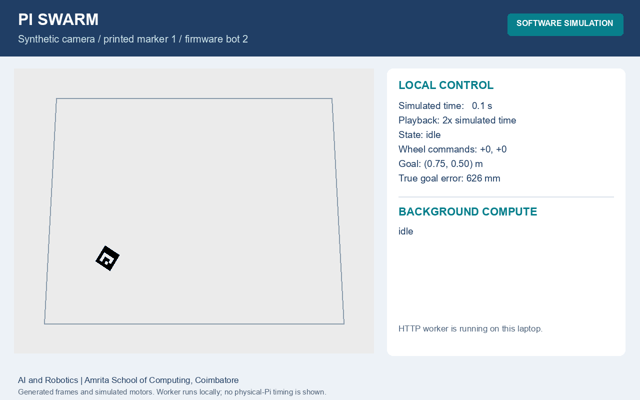

# Software simulation demonstration

[Download or play the MP4](https://github.com/Kapilkannaa/pi-swarm-robotics/releases/download/review2-2026-11-03/Pi-Swarm-Simulation.mp4)



This 24-second recording uses generated camera frames, the project's ArUco
tracker, adaptive burst controller, differential-drive world and firmware model.
It is **software simulation**, not footage of the dismantled robots.

## Scenes

| Video time | Scene |
|---|---|
| 0:00-0:01 | Animated invitation to watch the simulation |
| 0:01-0:04 | Navigation begins; marker tracking and lost-marker zero commands |
| 0:04-0:08 | Midpoint explanation of camera, local control and Pi computation |
| 0:08-0:16 | Navigation resumes, worker response and arrival |
| 0:16-0:20 | Navigation and offload summary |
| 0:20-0:24 | Verified burst-control and adaptation highlights |

The navigation scene plays at twice simulated time. One real authenticated HTTP
request is made to a local instance of `swarm.offload_server.Worker`. The service
is the same compute-only implementation intended for the Raspberry Pi, but it runs
on the laptop here. Its response is advisory and is never applied to wheel control.

## Recorded result

- Firmware bot 2 is tracked through printed marker 1.
- The goal is (0.75, 0.50) m in a 1.00 by 0.75 m simulated arena.
- Arrival occurs after 17.45 simulated seconds with 20.7 mm true final error.
- During the explicit marker occlusion, all controller wheel commands are zero.
- Three candidate profiles each complete 12/12 worker rollouts for this request.

This is one illustrative run. It is distinct from the two-robot scenario statistics
in the report and does not measure hardware arrival error, braking distance or Pi speed.

## Rebuild and inspect

```sh
python -m pip install -r requirements-demo.txt
python scripts/render_demo.py
```

The renderer needs local loopback HTTP access. It contacts no physical camera or robot.
Its trajectory uses random seed 7; video encoding and worker timing can vary by host.

| File | Purpose |
|---|---|
| `pi-swarm-simulation.mp4` | Complete H.264 recording |
| `simulation-preview.gif` | Downsampled animated excerpt |
| `simulation-preview.png` | One navigation frame |
| `demo-summary.json` | Goal, final error, duration and validation checks |
| `demo-trajectory.csv` | Per-step states and wheel commands |
| `demo-worker-result.json` | Actual local HTTP response, host label anonymized |

The frames and interface graphics are generated from project code; no external
stock footage or hardware recording is used.
